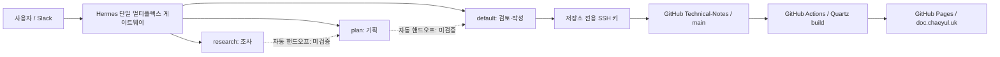

# Hostinger VPS의 Hermes 멀티 에이전트와 Quartz 배포: 구축 메모 리뷰

> **2026-11-24 기술 리뷰.** 제공된 구축 메모를 그대로 실행하지 않았다. 메모의 `docker exec`, here-document, 스마트 따옴표, HTML escape, Slack 멘션 자리표시자는 실행 가능한 배포 스크립트가 아니며, 설정과 증거를 대조해 문서로 다시 작성했다. 같은 주제의 [기존 검증 기록](./hermes-multiplex-vps-verified-draft-20261124.md)과 함께 읽을 수 있는 상세 리뷰다.

## 1. 아키텍처: 확인된 흐름과 목표 흐름

현재 Hostinger 관리 컨테이너에서 `default`, `plan`, `research` 프로필을 단일 게이트웨이가 서비스한다. `gateway_state.json`의 `served_profiles`가 세 프로필을 열거하고, 기본 `config.yaml`에서 `gateway.multiplex_profiles: true`가 확인됐다. 실행 환경의 CPU는 2 vCPU, `/proc/meminfo`의 메모리 총량은 약 5.8 GiB였다. 제공 메모의 ‘80 GB 디스크’와 ‘RAM 사용률 33% 유지’는 같은 시점의 측정 로그를 확보하지 못했으므로 확정치로 적지 않는다.

- **확인됨:** 게이트웨이의 세 프로필 서빙, GitHub 저장소 SSH 푸시, Quartz 빌드와 GitHub Pages 배포 및 공개 글 응답. 기존 [공개 전환 커밋](https://github.com/ttlojs-john/Technical-Notes/commit/dc1320367c48662d3c1814e3cd04271eac6f98ca)과 [Actions 실행](https://github.com/ttlojs-john/Technical-Notes/actions/runs/45492202029)에서 배포 단계 성공을 확인할 수 있다.
- **미검증:** `@research → @Plan → @chaeyulai`가 같은 Slack 스레드에서 앞 결과를 다음 입력으로 넘기고 끝까지 완료하는 자동 릴레이. 프로필 연결이나 각 봇의 개별 대화는 그 증거가 아니다. 당시 `research`와 `Plan`의 OpenRouter 무료 모델은 일일 한도 HTTP 429를 반환해 실제 리뷰 호출도 끝나지 않았다.

## 2. 실제 구성에서 확인한 설정

- `research` 및 `plan` 프로필은 각각 `/opt/data/profiles/` 아래 분리돼 있으며 서로 다른 모델을 지정한다: `baidu/ernie-5.5-flash-preview:free`와 `nvidia/nemotron-3-ultra-550b-a55b:free`. 기본 프로필은 Hostinger Router의 `smart-coding`을 사용한다. 모델 설정이 있다고 해서 무료 모델 호출 성공까지 보장하지는 않는다.
- 두 보조 프로필의 `config.yaml`에는 Slack의 `group_policy: mention_only`, `read_thread_history: true`, `ignore_bots: false`, `max_thread_turns: 5`가 있다. 이는 봇 메시지 처리 및 스레드 길이에 대한 설정 확인이며, **단방향 DAG를 강제하거나 루프가 결코 발생하지 않는다는 보장은 아니다.** Slack 앱 토큰과 봇 토큰은 프로필별 비밀 저장소에서 분리 관리해야 한다.
- 공개 메모에서 주장한 `disabled_tools`에 의한 *완전 읽기 전용*과 `approvals.mode: require_approval`·`timeout_seconds: 300`에 의한 *모든 파일 작업 전 승인*은 현재 세 프로필의 설정에서 확인되지 않았다. Hermes 문서의 `approvals.mode`는 `smart`, `manual`, `off`이고 명령 승인과 파일 편집 승인은 별개다. 따라서 이 시스템을 ‘제로 트러스트 격리 완료’라고 홍보하지 않는다. 실제로 이전 승인 과정도 사용자의 게시 승인과 Git 작업 제어였지 전역 HIL 설정의 증거는 아니다.

## 3. 배포 파이프라인과 이미지 생성

기존 블로그 저장소의 원격은 `git@github.com:ttlojs-john/Technical-Notes.git`이다. VPS의 저장소 전용 SSH 키 파일은 권한 `600`이고, 앞선 `main` 푸시와 원격 SHA 일치로 **이 저장소에 대한 쓰기 동작**을 확인했다. `.github/workflows/deploy.yml`은 `main` 푸시 후 Node 22에서 `npm ci` 및 `npx quartz build`를 거쳐 **GitHub Pages**로 배포한다. Netlify/Vercel 배포가 아니다.

메모에 있는 `/opt/data/scripts/generate_blog_image.py`는 Recraft 모델을 요청하도록 작성된 로컬 스크립트이지만, **이번 글의 대표 이미지를 그 모델이 생성했다고 주장하지 않는다.** 이번 대표 이미지는 별도 이미지 생성 도구로 생성해 PNG 형식과 파일 경로를 확인했다. 초안 원문에 보이는 자격증명 패턴과 Slack ID 자리표시자는 실제 키나 ID가 아니므로 게시 글에서 제거했다.

## 4. 트러블슈팅 기록을 읽는 법

1. **프로필별 독립 게이트웨이 거절:** 멀티플렉스가 활성화된 동일 설치에 프로필별 게이트웨이 프로세스를 중복 설치하는 대신 기본 게이트웨이의 `served_profiles`와 프로필 상태를 확인한다. 공식 [멀티플렉스 문서](https://hermes-agent.nousresearch.com/docs/user-guide/multi-profile-gateways)도 named profile은 기본 게이트웨이에 부착되도록 설명한다. 개별 컨테이너를 실제로 언제 생성·제거했는지의 로그는 이 리뷰에서 재현하지 않았다.
2. **경로·권한 혼선:** Hostinger의 지속 데이터는 `/opt/data`에 있다. `HOME=/root`를 기본 가정하거나 `/root/.hermes/profiles`를 표준 홈으로 복제하는 수동 절차를 권장하지 않는다. 프로필 경로는 실제 `$HERMES_HOME` 및 관리형 설치 상태를 기준으로 확인한다.
3. **Slack 봇 토큰 충돌:** 같은 봇 자격증명을 여러 프로필에 복사하면 충돌할 수 있다. 메모는 과거의 `@Plan` 오인증과 토큰 분리를 보고하지만, 민감한 토큰이나 인증 로그 원문을 재게시하지 않는다. 종단 간 연쇄 검증은 별개다.
4. **YAML 오류:** 들여쓰기 기반 설정 파일을 단순 문자열 치환으로 고치지 않는다. 관리형 Hermes 설정 변경은 `hermes config set`으로 수행하고 `hermes config check`로 확인한다. 제공된 과거 오류 메시지는 테스트 기록으로만 취급하며 오늘 재현한 오류라고 주장하지 않는다.
5. **저장소 경로:** SSH 인증 성공만으로 모든 저장소에 대한 쓰기 권한이 증명되지는 않는다. 정확한 `ttlojs-john/Technical-Notes` 원격에 성공적으로 푸시하고 원격 SHA가 일치하는지 확인해야 한다.

## 5. 다음 검증 항목

- Slack 스레드 하나에서 세 봇의 입력·출력 메시지 ID와 이전 단계 산출물 전달 여부를 남겨 자동 릴레이를 재시험한다. 무료 모델의 일일 한도 문제가 해소돼야 한다.
- 읽기 전용 도구 정책과 승인 게이트를 실제로 설정하려면 지원되는 설정 키와 동작 범위를 확인한 후 별도 권한 테스트를 한다. 현재 상태를 과장해 ‘격리 완료’로 표기하지 않는다.
- 공개 전 인덱스 생성기가 미승인 `draft` 글의 링크를 함께 넣지 않는지 diff를 검사한다. 생성된 대표 이미지와 게시 본문은 공개 저장소에 올라가면 누구나 접근할 수 있다.

**참고:** [Hermes Slack 가이드](https://hermes-agent.nousresearch.com/docs/user-guide/messaging/slack), [Hermes 설정 가이드](https://hermes-agent.nousresearch.com/docs/user-guide/configuration), 저장소의 `quartz.config.ts` 및 `.github/workflows/deploy.yml`.
