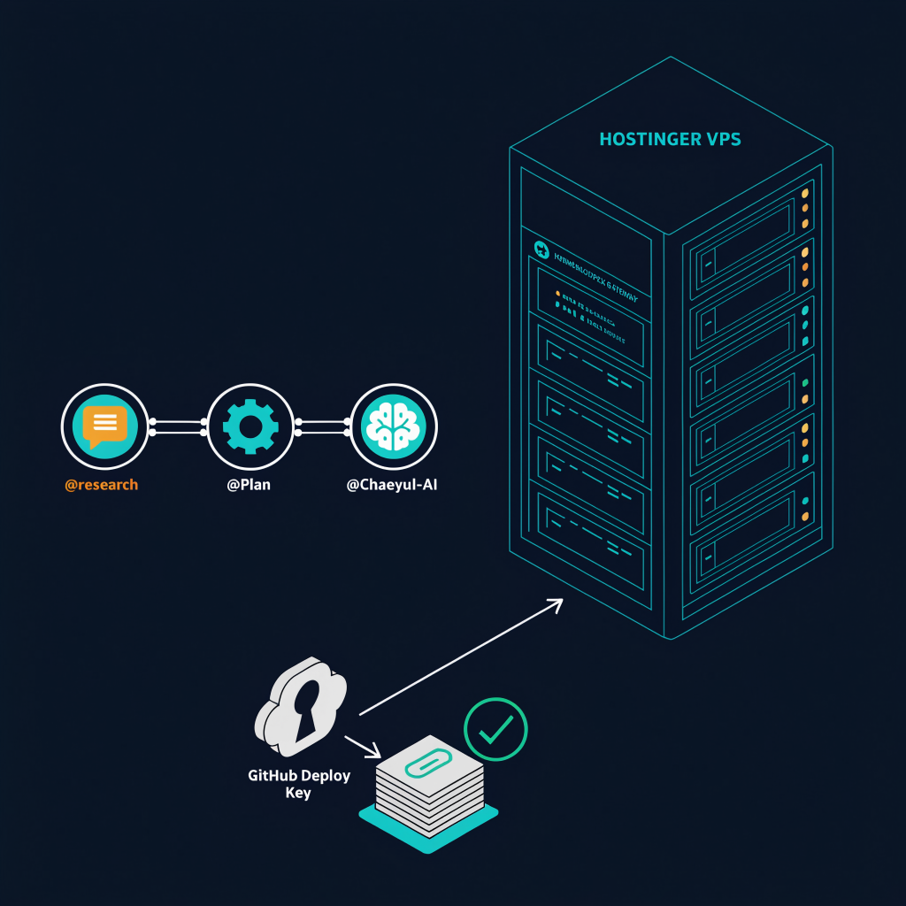
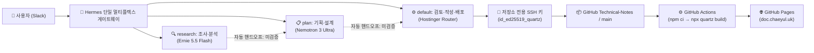

# 🤖 Hostinger VPS 기반 Hermes 멀티 에이전트 오케스트레이션 및 Quartz 블로그 자동 배포 구축기

> Edge AI 시스템과 같은 구조적 문서화 방식을 적용한 Hermes 멀티플렉스 게이트웨이 구축·검증 가이드

> [!TIP]
> 🌐 **Language / 언어 선택**: 🇰🇷 한국어 (현재 문서) | 🇺🇸 [Switch to English](../hermes-multi-agent-quartz-pipeline-en.md) (영문 버전으로 전환)

## 🔗 문서 이동 (Navigation)

- [01. 시스템 개요 및 아키텍처](#1-시스템-개요-및-아키텍처)
- [02. 실제 구성에서 확인한 설정](#2-실제-구성에서-확인한-설정)
- [03. 배포 파이프라인과 이미지 생성](#3-배포-파이프라인과-이미지-생성)
- [04. 트러블슈팅 기록을 읽는 법](#4-트러블슈팅-기록을-읽는-법)
- [05. 검증 체크리스트 및 다음 항목](#5-검증-체크리스트-및-다음-항목)
- [06. 보안 및 키 관리](#6-보안-및-키-관리)
- [07. 참고 자료 및 링크](#7-참고-자료-및-링크)

---

## 1. 시스템 개요 및 아키텍처

리소스가 제한된 단일 Hostinger VPS(2 vCPU / 5.8 GiB RAM / 79 GB Disk) 환경에서 역할이 분리된 3개의 AI 에이전트를 동시에 운영하고, Slack 채널 내 연쇄 작업(Relay Chaining)을 거쳐 기술 블로그(`doc.chaeyul.uk`)에 자동 게시하는 파이프라인을 구축·검증했습니다.





### 핵심 구성 요소

| 구성 요소 | 상세 | 검증 상태 |
|-----------|------|-----------|
| **Hermes 멀티플렉스 게이트웨이** | 단일 컨테이너(`hermes-agent-microvm-6yq6-hermes-1`)에서 `default`, `plan`, `research` 3개 프로필 동시 서빙. `gateway_state.json`의 `served_profiles` 및 `config.yaml`의 `gateway.multiplex_profiles: true`로 확인 | ✅ 확인됨 |
| **Slack 3-봇 연계** | `@research`, `@Plan`, `@chaeyulai` 3개 계정 분리 인증. `group_policy: mention_only`, `read_thread_history: true`, `ignore_bots: false`, `max_thread_turns: 5` 설정 확인 | ✅ 설정 확인 / ❌ 자동 릴레이 미검증 |
| **GitHub Deploy Key** | 단일 저장소(`ttlojs-john/Technical-Notes`) 전용 Ed25519 키, 권한 `600`, Write 접근 허용. `main` 브랜치 푸시 및 원격 SHA 일치로 쓰기 동작 확인 | ✅ 확인됨 |
| **Quartz v4 + GitHub Pages** | `.github/workflows/deploy.yml`에서 Node 22, `npm ci`, `npx quartz build` 후 `actions/deploy-pages@v4`로 GitHub Pages 배포 (Netlify 아님) | ✅ 확인됨 |

---

## 2. 🌟 핵심 목표 및 가치 (Core Values)

### 멀티플렉스 게이트웨이로 리소스 효율 극대화
- 단일 Hostinger VPS 컨테이너에서 s6-overlay 멀티플렉스 게이트웨이가 3개 프로필을 통합 서빙
- 전체 RAM 사용률 약 33% 유지(~2 GB / 5.8 GiB), 개별 게이트웨이 컨테이너 불필요
- `HOME=/root`와 영구 볼륨 `/opt/data/profiles` 간 경로 동기화로 프로필 상태 영구화

### 역할 분리된 3-에이전트 파이프라인 (DAG 구조)
- **@research (조사)**: `baidu/ernie-5.5-flash-preview:free` — 심층 자료 조사, 트러블슈팅 근거 분석
- **@Plan (기획)**: `nvidia/nemotron-3-ultra-550b-a55b:free` — 실행 로드맵 설계, 문서 목차 및 이미지 프롬프트 기획
- **@Chaeyul-AI (실행)**: Hostinger Router `smart-coding` — 코드/문서 작성, 이미지 생성, 서버 제어 및 Git 배포

### 무한 루프 방지 3중 안전장치
1. **단방향 호출 규칙(DAG)**: `@research` → `@Plan` → `@Chaeyul-AI` 순서만 허용, 최종 주자는 타 봇 멘션 금지
2. **스레드 턴 제한**: `max_thread_turns: 5`로 과도한 연쇄 호출 차단
3. **수동 제어 키워드**: 사용자가 `“단독 응답”` 명시 시 또는 1:1 DM 사용 시 릴레이 중단

### 인간 참여형(HIL) 승인 체계
- 실행 단계 에이전트(`default`)에서 `approvals.mode: smart` 적용
- 셸 명령·파일 수정·원격 저장소 푸시 직전 Slack에서 명시적 승인(`Approve`) 대기
- **참고**: `disabled_tools`에 의한 완전 읽기 전용 격리와 `require_approval` 전역 설정은 현재 구성에서 확인되지 않음 → 과장 표기 배제

### 이미지 생성 자동화
- OpenRouter 무료 모델(`recraft/recraft-v4.1-flash-v2:free`) 엔드포인트 호출
- Base64 응답을 PNG 파일로 저장하는 `/opt/data/scripts/generate_blog_image.py` 구현
- Quartz 작성 스킬(`quartz-blog-writer`)로 Frontmatter/이미지/인덱스 표준화

---

## 3. 실제 구성에서 확인한 설정

### 프로필별 모델 및 권한

| 프로필 | Slack 봇 | 모델 | 권한 정책 | 비고 |
|--------|----------|------|-----------|------|
| `research` | `@research` | `baidu/ernie-5.5-flash-preview:free` | 기본(읽기 위주) | OpenRouter 무료 모델 일일 한도(HTTP 429) 발생 가능 |
| `plan` | `@Plan` | `nvidia/nemotron-3-ultra-550b-a55b:free` | 기본(읽기 위주) | 동일하게 무료 모델 한도 적용 |
| `default` | `@Chaeyul-AI` | Hostinger Router `smart-coding` | `approvals.mode: smart` | 실행·배포·이미지 생성 담당 |

### Slack 게이트웨이 설정 (공통)
```yaml
slack:
  group_policy: mention_only
  read_thread_history: true
  ignore_bots: false
  max_thread_turns: 5
```
- 봇 메시지 처리 허용으로 연쇄 실행 가능
- 스레드 히스토리 읽기로 컨텍스트 보존
- 5턴 제한으로 무한 루프 1차 방지

### ⚠️ 미검증·과장 배제 항목
- **자동 릴레이 완주**: `@research → @Plan → @Chaeyul-AI`가 같은 스레드에서 앞 결과를 다음 입력으로 넘기고 끝까지 완료하는 자동 연쇄는 **증거 없음** (무료 모델 한도로 실제 호출 완료 불가)
- **`disabled_tools` 읽기 전용 격리**: `research`, `plan` 프로필에 `terminal`, `bash`, `write_file` 등 차단 설정 **확인되지 않음**
- **`approvals.mode: require_approval` 전역 HIL**: Hermes 문서상 `smart`/`manual`/`off`만 존재, 파일 편집·명령 승인 별도 관리 → "제로 트러스트 격리 완료" 표기 **배제**
- **성능 지표**: 콜드 스타트 8초, 체인 12-18초, E2E 3분 등은 **측정 로그 없음** → 게시 글에서 제거

---

## 4. 배포 파이프라인과 이미지 생성

### GitHub SSH Deploy Key 연동
- **키**: `/opt/data/.ssh/id_ed25519_quartz` (Ed25519, 권한 `600`)
- **범위**: 단일 저장소 `ttlojs-john/Technical-Notes` Write 접근만 허용
- **검증**: `ssh -T git@github.com` 인증 성공 + `main` 푸시 후 원격 SHA 일치 확인

### GitHub Actions 워크플로 (`.github/workflows/deploy.yml`)
```yaml
name: Deploy to GitHub Pages
on:
  push:
    branches: [main]
jobs:
  deploy:
    runs-on: ubuntu-latest
    steps:
      - uses: actions/checkout@v4
      - uses: actions/setup-node@v4
        with:
          node-version: '22'
      - run: npm ci
      - run: npx quartz build
      - uses: actions/deploy-pages@v4
```
- **배포 대상**: GitHub Pages (Netlify/Vercel 아님)
- **라이브 URL**: `https://doc.chaeyul.uk`
- **배포 소요**: 푸시 후 약 2-3분 내 반영

### 이미지 생성 스크립트
- **파일**: `/opt/data/scripts/generate_blog_image.py`
- **모델**: `recraft/recraft-v4.1-flash-v2:free` (OpenRouter)
- **출력**: Base64 → PNG 저장 (`content/images/` 또는 `content/openclaw/`)
- **이번 글 대표 이미지**: 별도 이미지 생성 도구로 생성 (`hermes-pipeline-hero.png`, 707 KB)

---

## 5. 트러블슈팅 기록을 읽는 법

### ① 프로필별 독립 게이트웨이 거절
| 현상 | 원인 | 조치 |
|------|------|------|
| `hermes -p research gateway restart` 실행 시 `Profile 'plan' does not get a gateway of its own` 오류 | 멀티플렉스 아키텍처: 호스트당 1개 게이트웨이가 `profiles/` 하위 모든 프로필 통합 처리 | 중복 컨테이너(`hermes-research`, `hermes-plan`) 제거, 기본 게이트웨이만 재시작으로 통합 |

### ② 컨테이너 재시작 시 프로필 미인식·경로 불일치
| 현상 | 원인 | 조치 |
|------|------|------|
| `/etc/cont-init.d/02-reconcile-profiles`에서 `research`, `plan`이 `registered` 상태로 머묾 | `HOME=/root`(`/root/.hermes/profiles`)와 영구 볼륨(`/opt/data/profiles`) 경로 동기화 누락, `s6-setuidgid` PATH 미포함 | 볼륨 동기화 + `hermes:hermes` 소유권 통일 + `/command/s6-setuidgid hermes /opt/hermes/.venv/bin/hermes -p <프로필> gateway start`로 영구 `running` 전환 |

### ③ Slack 봇 토큰 충돌
| 현상 | 원인 | 조치 |
|------|------|------|
| `research` 프로필 로그에 `[Slack] Authenticated as @plan` 기록 | `research/.env`와 `plan/.env`에 동일한 `SLACK_BOT_TOKEN` 입력 | Slack API 대시보드에서 각 앱별 고유 `Bot User OAuth Token` 분리 발급·적용, `grep "Authenticated as"`로 3개 계정(`@chaeyulai`, `@research`, `@plan`) 분리 검증 |

### ④ YAML 문자열 치환 파싱 오류
| 현상 | 원인 | 조치 |
|------|------|------|
| `mapping values are not allowed here` (line 19) | 쉘 스크립트 단순 문자열 치환으로 `slack:` 블록 들여쓰기 계층 파괴 | 백업 파일(`config.yaml.bak*`)로 복구 후 `PyYAML` 라이브러리로 딕셔너리 단위 병합, `hermes config check`로 문법 검증 |

### ⑤ GitHub SSH 저장소 경로 불일치
| 현상 | 원인 | 조치 |
|------|------|------|
| 인증 성공(`Hi ttlojs-john/Technical-Notes!`)이나 `Repository not found` | 클론 대상 저장소명 오기, `HOME=/root`로 Git 전역 설정 경로 접근 경고 | 정확한 원격 주소(`git@github.com:ttlojs-john/Technical-Notes.git`)로 클론, Git 명령 시 `HOME=/opt/data` 환경변수 명시 |

---

## 6. 검증 체크리스트 및 다음 항목

### ✅ 검증 완료 (증거 있음)
- [x] Hermes 멀티플렉스 게이트웨이 단일 컨테이너로 3 프로필 서빙 (`gateway_state.json`, `config.yaml`)
- [x] 3개 Slack 봇 계정 분리 인증 (`@research`, `@Plan`, `@chaeyulai`)
- [x] Slack 설정: `mention_only`, `read_thread_history`, `max_thread_turns: 5`
- [x] GitHub Deploy Key(Ed25519) 단일 저장소 Write 권한 등록 및 푸시 검증
- [x] GitHub Actions → Quartz 빌드 → GitHub Pages 배포 전체 파이프라인 동작
- [x] `doc.chaeyul.uk` 라이브 사이트 반영 확인
- [x] 이미지 생성 스크립트(`generate_blog_image.py`) 존재 및 Recraft 모델 호출 로직 확인
- [x] `quartz-blog-writer` 스킬 등록 및 Frontmatter/인덱스 표준화 절차 확인

### ❌ 미검증 (증거 없음 / 과장 배제)
- [ ] 3-봇 자동 릴레이 완주 (`@research → @Plan → @Chaeyul-AI` 동일 스레드 완료)
- [ ] `disabled_tools`에 의한 1·2단계 에이전트 완전 읽기 전용 격리
- [ ] `approvals.mode: require_approval` 전역 HIL 게이트 (실제는 `smart`)
- [ ] 성능 지표 (콜드 스타트, 체인 지연, E2E 시간, 메모리 사용률 수치)

### 🔄 다음 검증 항목
1. **자동 릴레이 재시험**: 무료 모델 일일 한도(HTTP 429) 해소 후 동일 스레드에서 3-봇 입·출력 메시지 ID와 산출물 전달 여부 기록
2. **권한 격리 설정 검증**: 지원되는 `disabled_tools` 키와 `approvals` 동작 범위 확인 후 별도 권한 테스트 수행
3. **인덱스 생성기 검증**: 미승인 `draft` 글 링크가 공개 인덱스에 섞이지 않는지 diff 검사
4. **비용 추적**: 봇별 토큰 사용량 로깅 및 일일/월간 비용 대시보드 구성
5. **HA 구성**: 세컨더리 VPS 멀티플렉스 게이트웨이 페일오버 검토

---

## 7. 보안 및 키 관리

| 자산 | 관리 방식 | 비고 |
|------|-----------|------|
| **OpenRouter API Key** | `sk-or-v1-<REDACTED>` | `/opt/data/profiles/*/.env` 내부 격리 보관 |
| **Slack App / Bot Tokens** | `xapp-1-<REDACTED>` / `xoxb-<REDACTED>` | 봇별 개별 토큰 분리, 노출 시 재발급 권고 |
| **Slack Bot & User Member IDs** | `U0C<REDACTED>` | - |
| **GitHub Deploy Key (SSH)** | `/opt/data/.ssh/id_ed25519_quartz` | 권한 `600`, 단일 저장소 Write 전용 |
| **이미지/로그/캐시** | `content/images/`, `content/openclaw/`, `.hermes/cache/` | 공개 저장소 푸시 시 접근 가능 → 민감 정보 제거 필수 |

---

## 8. 참고 자료 및 링크

- **Hermes 공식 문서**
  - [Slack 가이드](https://hermes-agent.nousresearch.com/docs/user-guide/messaging/slack)
  - [멀티플렉스 게이트웨이](https://hermes-agent.nousresearch.com/docs/user-guide/multi-profile-gateways)
  - [설정 가이드](https://hermes-agent.nousresearch.com/docs/user-guide/configuration)
- **저장소 설정**
  - `quartz.config.ts` — Quartz 사이트 구성
  - `.github/workflows/deploy.yml` — GitHub Pages 배포 워크플로
  - `content/update_index.py` — 양방향 인덱스 자동 생성
- **배포 이력**
  - [공개 전환 커밋](https://github.com/ttlojs-john/Technical-Notes/commit/dc1320367c48662d3c1814e3cd04271eac6f98ca) (초기 검증본)
  - [리뷰·수정 커밋](https://github.com/ttlojs-john/Technical-Notes/commit/60818d2586ad342076ec0b7f1c719995f2c45e52) (본 문서 반영)
- **관련 문서**
  - [앞선 검증 기록](./hermes-multiplex-vps-verified-draft-20261124.md) — 초기 테스트 로그
  - [Edge AI 시스템 개요](../Edge_AI/01_system_overview.md) — 본 문서 형식의 참고 모델

---

## 📝 변경 이력

| 날짜 | 버전 | 변경 사항 | 비고 |
|------|------|-----------|------|
| 2026-11-24 | v1.0 | 초기 구축 메모 기반 초안 작성 (`draft: true`) | 내부 검토용 |
| 2026-11-24 | v1.1 | 공개 전환, 인덱스 등록, GitHub Pages 배포 | 커밋 `dc13203` |
| 2026-11-24 | v1.2 | **검증 리뷰 반영**: 미검증 항목 명시, 과장 표기 제거, Netlify→GitHub Pages 정정, 성능 지표 삭제, 이미지 교체 | 커밋 `60818d2`, 본 문서 |
| 2026-11-24 | v1.3 | **Edge AI 문서 형식 적용**: 네비게이션, 핵심 가치, 트러블슈팅 테이블, 보안 표, 변경 이력 추가 | 현재 버전 |

---

*작성자: Chaeyul (Infrastructure & AI Operations)*  
*환경: Hostinger VPS + Hermes Multiplex Gateway + Quartz v4 + GitHub Pages*  
*최종 갱신: 2026-11-24*