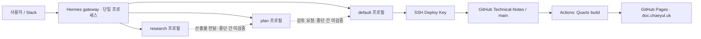

# 🤖 02. Hermes 멀티플렉스 게이트웨이·Slack·Quartz 배포 테스트
> **Hostinger VPS · 3프로필 구성 · 배포 검증 상세 기록**

> [!TIP]
> 🌐 **Language / 언어 선택**: **🇰🇷 한국어 (현재 문서)** · 영문판 미작성

---

## 🔗 문서 이동 (Navigation)
- [01. 시스템 개요 및 검증 기록](./hermes-multi-agent-quartz-pipeline-kr.md)
- **[02. 멀티플렉스 게이트웨이·Slack·배포 테스트 상세](./hermes-multiplex-vps-verified-draft-20261124.md)**
- [Edge AI 시스템 개요 (형식 참고)](../Edge_AI/01_system_overview.md)

---

## 1. 개요 (Overview)

2026년 11월 24일 Hostinger 관리 Docker 환경에서 Hermes의 단일 게이트웨이가 `default`, `plan`, `research` 프로필을 서비스하는지, 저장소 전용 SSH 키로 Quartz 글을 게시할 수 있는지 점검했다. **게이트웨이·저장소 푸시·Pages 배포는 확인했고 봇 간 자동 핸드오프는 미검증**으로 구분한다.

---

## 2. 🌟 핵심 목표 및 가치 (Core Values)

- **프로필 통합 운영**
  - 단일 프로세스에서 세 프로필을 서비스하되 각 프로필의 연결 상태를 따로 확인한다.
- **연쇄 실행의 증거화**
  - Slack 스레드의 단계별 메시지 ID와 전달된 산출물을 확보해 설정과 실제 성공을 구별한다.
- **배포 확인의 분리**
  - SSH 인증, Git 푸시, Actions 빌드·배포, 최종 공개 URL을 각각 확인한다.
- **초안 공개 범위 관리**
  - `draft: true`의 사이트 필터와 공개 GitHub 저장소의 원본 접근 권한은 별도로 다룬다.

---

## 3. 아키텍처 및 테스트 범위

사용자 의도는 Slack의 `@research`, `@Plan`, `@chaeyulai` 세 봇을 계획·조사·검토 단계에 연결하고, 산출물을 SSH Deploy Key로 GitHub에 전달해 Quartz 사이트에 배포하는 것이다. **프로필 3개가 동시에 연결되는 것과 실제 자동 핸드오프가 끝까지 성공하는 것은 다른 검증 항목**이다.

## 4. 게이트웨이 구성 확인

- `hermes profile list`에서 `default`, `plan`, `research` 세 프로필의 게이트웨이가 실행 중으로 표시됐다.
- `hermes gateway status`는 **PID 1881**, 기본 프로필에서 구동되는 게이트웨이를 보고했다. `gateway_state.json`의 `served_profiles`는 `default`, `plan`, `research`였다.
- `hermes -p research gateway status`와 `hermes -p plan gateway status`는 각각 **default-profile multiplexer를 통해 실행 중**이라고 보고했다. 별도의 세 게이트웨이가 필요하지 않다.
- 상태 파일에서 기본 프로필의 `slack`, `telegram`, `api_server` 연결 상태는 `connected`였다. 이것만으로 각 Slack 봇의 종단 간 메시지 응답 또는 봇 간 연쇄 완료를 입증하지는 못한다.
- 이 설치는 Hostinger 관리 환경이다. 게이트웨이 상태에 설치 산출물 동기화 경고가 출력됐으므로 별도 운영 점검 항목으로 남겨 둔다. 관리형 Hermes 자체를 수동 업데이트하는 절차는 여기서 다루지 않는다.

공식 문서에 따르면 멀티플렉스는 한 프로세스가 프로필별 어댑터·자격증명·세션을 분리해 서비스한다. **프로필 간 모델·토큰의 공유를 전제로 하지 않는다.** [Hermes 다중 프로필 게이트웨이 문서](https://hermes-agent.nousresearch.com/docs/user-guide/multi-profile-gateways).

## 5. 세 봇 연쇄 실행: 구성과 미검증 부분

설계된 작업 순서는 `@Plan`의 작업 분해 → `@research`의 근거 수집·초안 → `@chaeyulai`의 검토 및 승인 요청이다. 실제 작업에서는 요청자가 `@research`부터 시작하는 경우도 있으므로 단계의 시작점은 호출 메시지에 따라 달라진다. **현재 확인한 것은 세 프로필이 같은 게이트웨이에서 서비스된다는 사실과 각각의 Slack 대화가 생성됐다는 점까지다.** 동일 스레드에서 앞 봇의 출력이 다음 봇에게 자동 전달되고 세 번째 봇의 응답까지 돌아왔다는 메시지 ID·트레이스는 확보하지 못했다. 따라서 이 기록에서 ‘자동 연쇄 실행 성공’이라고 표기하지 않는다.

재검증 시에는 테스트 스레드 하나를 정해 다음 증거를 보존한다.

1. 첫 봇의 요청·응답 메시지 시각과 스레드 ID.
2. 다음 봇의 입력에 이전 단계 산출물이 포함됐는지, 각 프로필의 세션/로그로 확인.
3. 마지막 봇의 결과 및 승인 게이트가 실제 푸시 전에 멈췄는지 확인.

## 6. GitHub Deploy Key → Quartz 배포 경로

저장소 원격은 `git@github.com:ttlojs-john/Technical-Notes.git`이다. VPS의 SSH 설정에서 GitHub 접속용 키 경로는 `/opt/data/.ssh/id_ed25519_quartz`로 해석됐다. `ssh -T -o BatchMode=yes -o StrictHostKeyChecking=yes git@github.com` 호출은 `Hi ttlojs-john/Technical-Notes! You've successfully authenticated`를 반환했다. 이어 이 원격에 포스트와 이미지를 포함한 [커밋 `001ebbf`](https://github.com/ttlojs-john/Technical-Notes/commit/001ebbf58e6c84be3f762ab2a318cff943a9de18)를 `main`으로 푸시하고 `git ls-remote`로 원격 SHA 일치를 확인했다. **이 저장소에 대한 키의 푸시 권한이 실증됐다.**

저장소의 `.github/workflows/deploy.yml`은 `main` 푸시 때 Node 22에서 `npm ci`, `npx quartz build`를 실행한 다음 `actions/upload-pages-artifact@v3` 및 `actions/deploy-pages@v4`로 **GitHub Pages**를 배포하도록 구성되어 있다. Netlify/Vercel 경로가 아니다. Quartz의 `baseUrl`은 `doc.chaeyul.uk`이다. 위 커밋에 대한 [Actions 실행 #45491089433](https://github.com/ttlojs-john/Technical-Notes/actions/runs/45491089433)의 `build`와 `deploy` 작업은 모두 `success`로 완료됐다. 당시 글은 `draft: true`여서 **워크플로 성공이 그 시점에 글 페이지 공개를 의미하지는 않는다**. 공개 전환 커밋의 Pages 배포와 URL은 별도로 확인한다.

## 7. 공개 전환과 검증 범위

이 글의 `draft: true`를 제거해 Quartz의 `Plugin.RemoveDrafts()` 필터 대상에서 벗어나게 했다. 공개 저장소의 원본과 대표 이미지는 이전 초안 커밋 때부터 접근 가능했다. 카탈로그 갱신을 위해 `content/update_index.py`를 실행했지만, 스크립트가 **다른 미승인 초안의 `draft` 여부를 검사하지 않아** 생성된 인덱스에 그 초안들의 링크도 함께 들어갔다. 생성 결과를 검토한 후 인덱스를 원상 복구하고, 이번에 승인된 글의 링크만 공개 인덱스에 추가한다. 스크립트의 초안 필터 개선은 별도 작업으로 남긴다.

- **검증 완료:** 한 게이트웨이의 세 프로필 서비스(PID 1881 확인), GitHub SSH 키 인증 및 `main` 푸시, 이전 커밋의 Quartz 빌드·GitHub Pages 배포 작업 성공.
- **검증되지 않음:** 세 Slack 봇 사이의 자동 순차 핸드오프/맥락 전달 완료. 호출 실패·OpenRouter 무료 모델 일일 한도(HTTP 429)가 관찰됐으므로 프로필별 접속 상태를 연쇄 성공으로 간주하지 않는다.
- **공개 전환 확인:** [커밋 `dc13203`](https://github.com/ttlojs-john/Technical-Notes/commit/dc1320367c48662d3c1814e3cd04271eac6f98ca)의 [Actions 실행 #45492202029](https://github.com/ttlojs-john/Technical-Notes/actions/runs/45492202029)에서 `build`와 `deploy`가 성공했다. [공개 포스트](https://doc.chaeyul.uk/openclaw/hermes-multiplex-vps-verified-draft-20261124)가 열리고 메인 인덱스에 이 글의 링크가 나타나는 것도 확인했다. 다른 미승인 초안 링크는 인덱스에 포함되지 않았다.

## 참고

- [Hermes: Running Many Gateways at Once](https://hermes-agent.nousresearch.com/docs/user-guide/multi-profile-gateways)
- [Hermes: Multiplexing Gateway Internals](https://hermes-agent.nousresearch.com/docs/developer-guide/multiplexing-gateway)
- 로컬 검증 자료: `/opt/data/gateway_state.json`, 저장소의 `quartz.config.ts`, `quartz/plugins/filters/draft.ts`, `.github/workflows/deploy.yml`.
