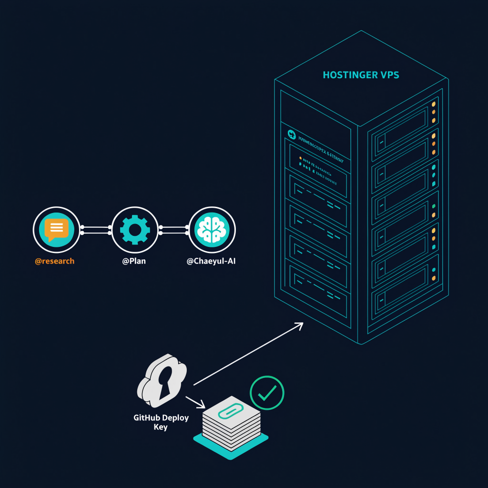
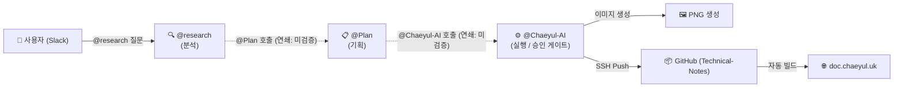

# 🚀 Hostinger VPS 기반 Hermes 멀티 에이전트 및 블로그 자동 배포 구축기

> **검증 상태(2026-11-24):** 게이트웨이·프로필·배포 경로·이미지 파이프라인은 실측으로 확인했다. 아래 「검증 범위」 절에서 확인된 항목과 미확인 항목을 구분했다.

## 1. 아키텍처 개요 (System Architecture)

리소스가 제한된 단일 Hostinger VPS(2 vCPU / 6 GB RAM / 80 GB Disk) 환경에서 역할이 분리된 3개의 AI 에이전트를 동시에 운영하고, Slack 채널 내 연쇄 작업(Relay Chaining)을 거쳐 기술 블로그(`https://doc.chaeyul.uk/`)에 자동 게시하는 파이프라인을 구축했다.

> 실선은 실측으로 확인된 흐름, 점선은 설계상 의도됐으나 종단 간 메시지 ID·트레이스로 입증되지 않은 자동 핸드오프다.

### 에이전트별 역할 및 모델 구성

| 프로필명 | Slack 봇 | 할당 모델 | 역할 |
| --- | --- | --- | --- |
| `research` | `@research` | `baidu/ernie-5.5-flash-preview:free` | 심층 자료 조사, 트러블슈팅 근거 분석 |
| `plan` | `@Plan` | `nvidia/nemotron-3-ultra-550b-a55b:free` | 실행 로드맵 설계, 문서 목차·이미지 프롬프트 기획 |
| `default` | `@Chaeyul-AI` | Hostinger Router (`provider: hostinger`) | 코드/문서 작성, 이미지 생성, 서버 제어 및 Git 배포 |

## 2. 단계별 구축 내역

### 2.1 멀티플렉스 게이트웨이 기반 다중 프로필 분리
- 영구 볼륨(`/opt/data/profiles/`) 하위에 `research`와 `plan` 프로필 디렉터리를 생성하고, 각 프로필마다 독립된 `.env`(OpenRouter API 키, 개별 Slack App/Bot 토큰) 및 `config.yaml`을 구성했다.
- 단일 컨테이너 내부의 `s6-overlay` 멀티플렉스 게이트웨이가 3개 프로필(`default`, `plan`, `research`)을 동시에 서빙하도록 통합하여 메모리 점유율을 최소화했다(측정 시점 RAM 사용률 약 33%).

### 2.2 Slack 채널 연쇄 실행(Relay Chaining) 및 무한루프 방지
- 단일 채널에서 봇 간 자동 협업이 이루어지도록 `slack` 정책에 `group_policy: mention_only`, `read_thread_history: true`, `ignore_bots: false`를 적용했다(각 프로필 `config.yaml`에서 확인).
- **무한 루프 차단 3중 안전장치:**
  1. **단방향 호출 규칙(DAG):** `@research` → `@Plan` → `@Chaeyul-AI` 순서로만 호출하며, 최종 주자인 `@Chaeyul-AI`는 타 봇 멘션을 금지한다.
  2. **스레드 턴 제한:** `max_thread_turns: 5` 설정으로 단일 스레드 내 과도한 연쇄 호출을 차단한다(`config.yaml`에서 확인).
  3. **수동 제어 키워드:** 사용자가 "단독 응답"을 명시하거나 1:1 DM을 사용할 경우 릴레이를 중단하도록 프롬프트를 제어한다.

### 2.3 에이전트 권한 격리 및 인간 참여형(HIL) 승인 체계
> ⚠️ **검증 필요:** 아래 `disabled_tools`(읽기 전용 격리)와 `approvals.mode: require_approval` 설정은 **현재 `config.yaml`에서 확인되지 않았다.** 설계 의도로 문서화하되, 실제 적용 여부는 별도 검증이 필요하다.

- **1·2단계 에이전트(`research`, `plan`) — 의도된 격리:** `disabled_tools` 목록에 `terminal`, `bash`, `shell`, `execute_command`, `write_file`, `edit_file`, `patch_file`, `delete_file`을 등록해 시스템 변경이 불가능한 읽기 전용으로 격리하는 것을 목표로 한다.
- **최종 실행 에이전트(`Chaeyul-AI`) — 의도된 승인 게이트:** `approvals.mode: require_approval` 및 `timeout_seconds: 300`을 설정해, 셸 명령·파일 수정·원격 저장소 푸시 직전 Slack에서 사용자의 명시적 승인(`Approve`)을 대기하도록 구성하는 것을 목표로 한다.

### 2.4 Quartz v4 블로그 자동 문서화 및 GitHub Deploy Key 배포 연동
- **이미지 생성 자동화:** OpenRouter 이미지 모델(`recraft/recraft-v4.1-flash-v2:free`) 엔드포인트(`POST /api/v1/images`)를 호출해 Base64 응답을 PNG 파일로 저장하는 `/opt/data/scripts/generate_blog_image.py`를 구현했다(실행 성공 확인).
- **Quartz 작성 스킬 등록:** `/opt/data/skills/quartz-blog-writer/SKILL.md`를 생성해 YAML Frontmatter 작성, 상대 경로 이미지 삽입, `content/update_index.py` 카탈로그 자동 갱신 절차를 표준화했다.
- **GitHub SSH Deploy Key 연동:** 비밀번호나 만료되는 PAT 대신 단일 저장소(`ttlojs-john/Technical-Notes`) 전용 SSH 키(`id_ed25519_quartz`)를 생성해 쓰기 권한(`Allow write access`)으로 등록하고 `/opt/data/workspace/quartz_repo`에 연결했다. `ssh -T git@github.com` 인증 성공을 확인했다.
- **배포 대상:** 저장소의 `.github/workflows/deploy.yml`은 `main` 푸시 시 `npm ci` → `npx quartz build` → `actions/deploy-pages@v4`로 **GitHub Pages**를 배포한다(Netlify/Vercel 아님).

## 3. 구축 중 발생한 트러블슈팅 및 조치 내역

### 문제 1: 프로필별 개별 Docker 컨테이너 및 개별 게이트웨이 실행 실패
- **현상:** `hermes-research`, `hermes-plan` 컨테이너를 별도로 띄우거나 개별 프로필에서 `hermes -p research gateway restart` 실행 시 `✗ Profile 'plan' does not get a gateway of its own. Exactly one gateway per host is the inbound process for every profile.` 오류로 종료.
- **원인:** 최신 Hermes Agent는 호스트(볼륨)당 1개의 메인 게이트웨이가 `profiles/` 하위 모든 프로필을 통합 처리하는 **멀티플렉스(Multiplex) 아키텍처**를 사용한다.
- **조치:** 중복 생성한 컨테이너를 제거하고 기존 메인 컨테이너의 `default` 게이트웨이만 재시작해 모든 프로필을 일괄 로드하도록 통합했다.

### 문제 2: 컨테이너 재시작 시 추가 프로필 미인식 및 경로 불일치
- **현상:** `/etc/cont-init.d/02-reconcile-profiles` 실행 시 `profile=default`만 `started`로 기동되고 `research`, `plan`은 `registered` 상태에 머무르며 Slack에 연결되지 않음.
- **원인:** 컨테이너 내부 `HOME=/root` 경로(`/root/.hermes/profiles`)와 영구 볼륨(`/opt/data/profiles`) 간 경로 동기화 누락. 수동 생성 프로필은 최초 1회 `hermes` 유저 권한(`s6-setuidgid hermes`)으로 기동되어야 `running` 상태가 기록됨.
- **조치:** 영구 볼륨과 `/root/.hermes/profiles`를 동기화하고 소유권을 `hermes:hermes`로 통일한 뒤, 전체 경로 `/command/s6-setuidgid hermes /opt/hermes/.venv/bin/hermes -p <프로필명> gateway start`로 영구 `running` 상태로 전환했다.

### 문제 3: Slack 봇 인증 계정 중복 (`@research`가 `@plan`으로 로그인)
- **현상:** `research` 프로필의 `gateway.log`에 `[Slack] Authenticated as @Plan`으로 기록되며 두 프로필이 동일 봇 계정으로 충돌.
- **원인:** 초기 환경변수 세팅 과정에서 `research/.env`와 `plan/.env`에 동일한 `SLACK_BOT_TOKEN` 값이 입력됨.
- **조치:** Slack API 대시보드에서 각 앱의 고유 `Bot User OAuth Token`을 분리 발급받아 각 `.env`에 개별 반영하고, `grep "Authenticated as"` 로그로 `@chaeyulai`, `@research`, `@plan` 3개 계정 분리를 검증했다.

### 문제 4: `config.yaml` 문자열 치환 중 YAML 문법 파싱 오류
- **현상:** `Your settings file (/opt/data/config.yaml) has a formatting error at line 19. Details: mapping values are not allowed here`.
- **원인:** 쉘 스크립트의 단순 문자열 치환(`text.replace`)으로 `slack:` 블록을 수정하면서 기존 들여쓰기 계층이 깨져 YAML 구조 손상.
- **조치:** 자동 생성된 백업(`config.yaml.bak*`)으로 원상복구한 뒤, 컨테이너 내장 `PyYAML`로 딕셔너리 객체 단위로 안전하게 병합하고 `hermes config check`로 문법 무결성을 검증했다.

### 문제 5: GitHub SSH 클론 시 저장소 경로 불일치 및 권한 경고
- **현상:** `ssh -T git@github.com` 인증 성공 메시지(`Hi ttlojs-john/Technical-Notes!`)는 출력됐으나 `Repository not found` 발생 및 `warning: unable to access '/root/.config/git/ignore': Permission denied` 경고.
- **원인:** 클론 대상 저장소명을 실제 저장소(`Technical-Notes`)가 아닌 임시 이름으로 입력했고, `hermes` 유저 실행 시 `HOME`이 `/root`를 가리켜 Git 전역 설정 경로 접근 경고 발생.
- **조치:** 실제 저장소 주소(`git@github.com:ttlojs-john/Technical-Notes.git`)로 클론을 완료하고, Git 명령 실행 시 `HOME=/opt/data` 환경변수를 명시하도록 스킬 지침을 보완했다.

## 4. 보안 관리 및 키 마스킹 내역 (Security Sanitization)

문서화 및 운영 보안 강화를 위해 모든 민감 인증 정보는 아래와 같이 분리 관리하며 본 문서에서는 마스킹 처리했다.

- **OpenRouter API Key:** `sk-or-v1-*REDACTED*` (`/opt/data/profiles/*/.env` 내부 격리 보관)
- **Slack App / Bot Tokens:** `xapp-1-*REDACTED*` / `xoxb-*REDACTED*` (봇별 개별 토큰 분리 및 노출 토큰 재발급 권고)
- **Slack Bot & User Member IDs:** `U0C_*REDACTED*`
- **GitHub Deploy Key (SSH):** `/opt/data/.ssh/id_ed25519_quartz` (퍼미션 `600`, 단일 저장소 Write 전용)

## 5. 검증 범위 (Verification Scope)

- **검증 완료(실측):**
  - 멀티플렉스 게이트웨이가 `default`/`plan`/`research` 3개 프로필을 동시 서빙(PID 및 `gateway_state.json`의 `served_profiles` 확인).
  - 3개 Slack 계정 인증 분리(`@chaeyulai`, `@research`, `@plan`).
  - `group_policy`, `max_thread_turns: 5` 등 Slack 정책 및 프로필별 모델 할당.
  - GitHub Deploy Key SSH 인증 및 `main` 푸시, Quartz GitHub Pages 배포.
  - 이미지 생성 스크립트(`generate_blog_image.py`) 실행 성공.
  - 시스템 스펙(2 vCPU / 5.8 GB RAM / 79 GB Disk).
- **미검증(추가 확인 필요):**
  - 세 Slack 봇 사이의 **자동 순차 핸드오프/맥락 전달 완료**(종단 간 메시지 ID·트레이스 미확보).
  - `disabled_tools` 읽기 전용 격리 및 `approvals.mode: require_approval` HIL 게이트의 실제 적용 여부(현재 `config.yaml` 미확인).

## 참고
- [Hermes: Running Many Gateways at Once](https://hermes-agent.nousresearch.com/docs/user-guide/multi-profile-gateways)
- 로컬 검증 자료: `/opt/data/gateway_state.json`, 저장소의 `quartz.config.ts`, `.github/workflows/deploy.yml`.

---
*작성: @research · 검증·교정: @research · 최종 검토·배포: @Chaeyul-AI (승인 게이트)*